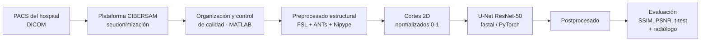

# TFG | Síntesis de RM T1 con contraste mediante Deep Learning en neuro-oncología

> **Synthetic T1 Post-Contrast MRI Imaging in Neuro-Oncology using Deep Learning on Multiparametric MRI**
>
> Trabajo Fin de Grado · Grado en Ingeniería Biomédica · Universidad Carlos III de Madrid · septiembre de 2023
>
> Tutores: Daniel Sanderson Moreno y Manuel Desco Menéndez (Bioingeniería, UC3M / Hospital General Universitario Gregorio Marañón)

## En 30 segundos

Entrené una red **U-Net con encoder ResNet-50** que genera la imagen de resonancia **T1 con contraste (gadolinio)** a partir de tres secuencias **sin contraste** (T1, FLAIR y SWI), con el objetivo de reducir el uso de contrastes basados en gadolinio en el seguimiento de pacientes con glioma. Diseñé el flujo completo: organización y limpieza de datos clínicos reales, preprocesado reproducible de neuroimagen, entrenamiento de 7 modelos en 4 experimentos y evaluación cuantitativa **y clínica** (valoración por un radiólogo con 20 años de experiencia).

| | |
|---|---|
| **Problema clínico** | El gadolinio mejora la detección de tumores, pero tiene coste, alarga el estudio y puede acumularse en el cerebro con administraciones repetidas |
| **Datos** | RM 3D de pacientes con glioma del HGUGM (1,5 T Philips Ingenia). 120 pacientes iniciales → 100 tras control de calidad → 40 usados en los experimentos (80 % entrenamiento / 20 % validación) |
| **Modelo** | U-Net 2D, encoder ResNet-50 preentrenado en ImageNet, entrada de 3 canales (T1 + FLAIR + SWI magnitud), salida T1 con contraste |
| **Stack** | Python · PyTorch · fastai · segmentation-models-pytorch · MONAI · nibabel · Nipype · FSL · ANTs · MATLAB |
| **Resultado principal** | SSIM ≈ 65 % y PSNR ≈ 23,5 dB en validación con el modelo final; el modelo detecta tumores y vasos, pero **no alcanza la precisión del contraste real** (ver limitaciones) |

## Flujo del proyecto



## Datos y protección de datos

Esta parte importa tanto como el modelo: los datos eran **datos de salud reales**.

- Los datos no podían exportarse del hospital sin más: se obtuvieron del PACS, se subieron a la plataforma **CIBERSAM**, donde se **seudonimizaron**, y solo entonces se descargaron para trabajar con ellos, conforme a la Ley Orgánica 3/2018 de Protección de Datos.
- El estudio contempló los aspectos éticos y de confidencialidad y la exención de consentimiento informado (anexo de la memoria).
- **Este repositorio no contiene imágenes, volúmenes ni resultados derivados de pacientes.** Solo código. Un `.gitignore` bloquea los formatos de imagen médica, y los notebooks se han publicado sin salidas para que no arrastren cortes de RM.

## Metodología

### 1. Organización de datos (`src/01_organizacion_datos`)
Script de MATLAB que descomprime las exportaciones, descarta series no necesarias (incluidas adquisiciones 2D), renombra las secuencias, separa magnitud y fase de SWI y **distingue T1 de T1 con contraste por hora de adquisición** (el exportador las nombraba igual). Se excluyeron 20 pacientes sin las cuatro secuencias: 120 → 100. La clasificación se comprobó paciente a paciente.

### 2. Preprocesado de neuroimagen (`src/02_preprocesado`)
Pipeline en Python (Nipype) que deja las cuatro secuencias comparables entre sí:

1. Reorientación a orientación estándar (RAS).
2. Recorte de cuello y hombros (`RobustFOV`).
3. Corrección del campo de sesgo (`N4BiasFieldCorrection`, ANTs).
4. Remuestreo isotrópico a 0,71875 mm con interpolación bilineal.
5. Extracción de cerebro con plantilla (`BrainExtraction`, ANTs), más rápida y precisa que la alternativa sin plantilla.
6. Corregistro de T1, FLAIR y SWI sobre el T1 con contraste (`FLIRT`, información mutua), midiendo la similitud antes y después.
7. Recorte (320×320×D → 178×126×D), troceado en cortes 2D y normalización a [0, 1].

El propio script guarda un **registro de comprobación por paso** para auditar cada volumen.

### 3. Modelo (`src/03_modelo_dl`)
- U-Net 2D con encoder ResNet-50 (`segmentation-models-pytorch`), entrenada con fastai.
- 60 épocas, política de un solo ciclo (`fit_one_cycle`), tasa de aprendizaje 0,0017 elegida con `lr_find`, *weight decay* 1e-3, aumento de datos (rotación ±10°, volteo) y guardado del mejor modelo por pérdida de validación.
- Funciones de pérdida implementadas a medida: **MS-SSIM**, **MAE**, su combinación y una **pérdida local** que enfoca el aprendizaje en las zonas hiperintensas (tumor y vasos).

### 4. Postprocesado (`src/04_postprocesado`)
Generación de la etiqueta alternativa T1-SUB (diferencia entre T1 con y sin contraste), pintado de las regiones predichas sobre el T1 y ajuste de rango dinámico y gamma.

## Experimentos y resultados

Cuatro experimentos, siete modelos. SSIM en % y PSNR en dB, media ± desviación típica sobre la validación.

| Exp. | Etiqueta | Pérdida | SSIM | PSNR |
|---|---|---|---|---|
| 1 | T1 con contraste | MS-SSIM | 65,74 ± 6,09 | 23,96 ± 1,88 |
| 1 | T1 con contraste | MAE | 63,85 ± 5,09 | 23,18 ± 1,53 |
| 1 | T1 con contraste | MS-SSIM + MAE | 65,80 ± 6,12 | 23,68 ± 1,80 |
| **2** | T1 con contraste | **MS-SSIM + MAE + local** | 65,35 ± 5,84 | 23,49 ± 1,66 |
| 3 | T1-SUB, pintado | MS-SSIM | 75,12 ± 5,32 | 18,61 ± 1,01 |
| 4 | T1-SUB, pintado + postprocesado | MS-SSIM | 76,17 ± 5,32 | 20,58 ± 1,04 |

(Tabla resumida: se muestra el mejor modelo de los experimentos 3 y 4; los resultados completos de los 7 modelos están en la memoria.)

**Lo más interesante del análisis no es la métrica más alta, sino por qué se descartó:**

- Las diferencias entre MS-SSIM y MS-SSIM + MAE **no fueron estadísticamente significativas** (t-test, p = 0,985 en SSIM y p = 0,765 en PSNR), así que las métricas solas no permitían decidir.
- El experimento 4 sacaba mejor SSIM que el 2 (diferencia significativa, p < 0,01), pero el radiólogo prefirió el 2: las imágenes del 4 parecían más reales, pero **introducían ruido**, que en diagnóstico puede traducirse en falsos positivos. La pérdida MAE se descartó por infraestimar vasos y, en los experimentos con T1-SUB, MS-SSIM + MAE sobreestimaba zonas realzadas, lo que el radiólogo penalizó por el riesgo de falsos positivos.
- **Modelo final: experimento 2 (MS-SSIM + MAE + pérdida local)**, elegido por criterio clínico además de numérico.

## Limitaciones y trabajo futuro

Lo dejo explícito porque en salud importa:

- La calidad global es inferior a la del estado del arte y las imágenes sintéticas **no sustituyen al contraste real** para planificación de tratamiento. Podrían servir como apoyo en el seguimiento de ciertos pacientes (por ejemplo, gliomas de bajo grado) para reducir la exposición a gadolinio.
- Muestra pequeña (40 pacientes). Al cierre de la memoria se estaba reentrenando con los 100 pacientes.
- Arquitectura 2D por límite de memoria de GPU; los modelos 3D y las GAN quedan como línea futura, igual que un estudio de ablación de las secuencias de entrada y entrenar la etiqueta residual sin valor absoluto.

## Estructura de esta carpeta

```
tfg/
├── README.md
├── requirements.txt
└── src/
    ├── 01_organizacion_datos/   # MATLAB: limpieza y clasificación de secuencias
    ├── 02_preprocesado/         # Python: reorientación, N4, extracción de cerebro, registro, cortes
    ├── 03_modelo_dl/            # Python: U-Net ResNet-50, pérdidas, entrenamiento y evaluación
    └── 04_postprocesado/        # Python + MATLAB: etiqueta T1-SUB, máscaras, ajuste de rango
```

> **Nota sobre reproducibilidad.** El código es el de un proyecto de investigación y se publica tal cual se usó: son notebooks con las rutas sustituidas por `DATA_ROOT`. Sin los datos clínicos (que no se pueden compartir) no se puede ejecutar de principio a fin. Las herramientas externas (FSL y ANTs) hay que instalarlas aparte; ver `requirements.txt`.

## Qué aporta este proyecto a un perfil de ingeniería de datos en salud

- **Tratamiento de datos clínicos reales** con seudonimización, normativa (RGPD / LOPDGDD) y control de calidad documentado.
- **Pipeline de datos reproducible y auditable** (extracción → limpieza → transformación → carga al modelo), con comprobaciones en cada paso.
- **Python aplicado a ML** (PyTorch, fastai), pérdidas personalizadas y estadística (t-test).
- **Validación con el usuario clínico**: decisiones de diseño tomadas con un radiólogo, no solo con métricas.
