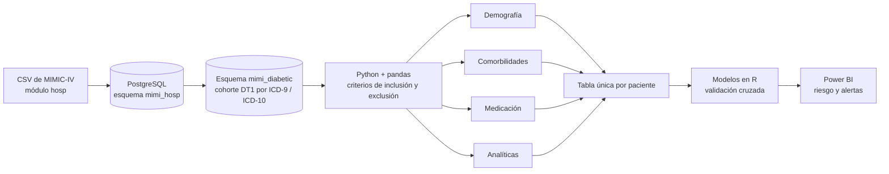
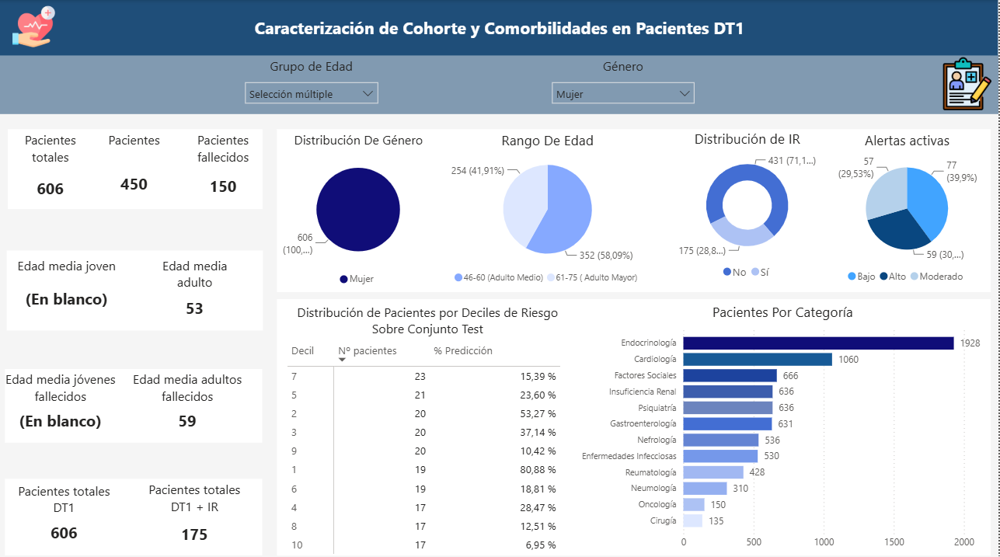
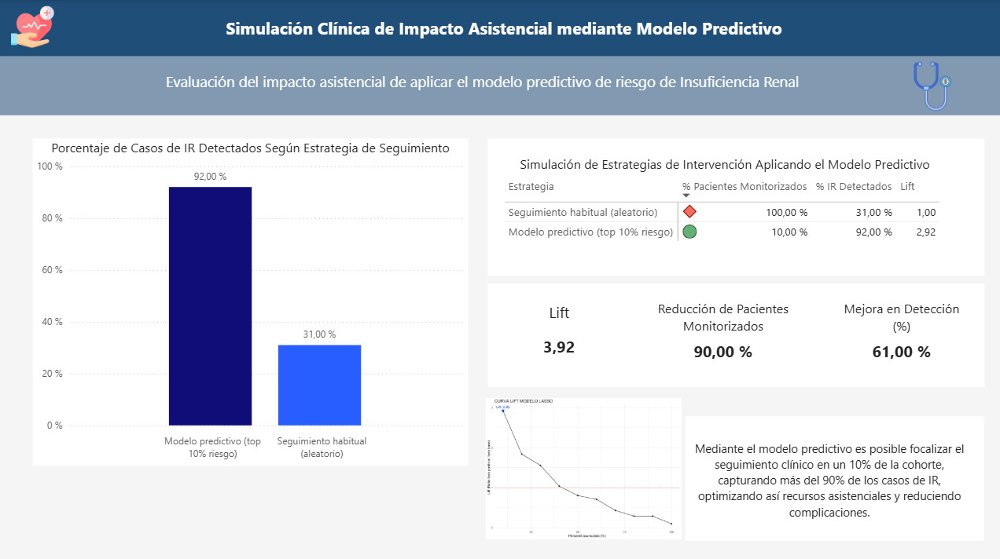

# TFM | Predicción del riesgo de insuficiencia renal en diabetes tipo 1 con MIMIC-IV

> **Optimización del Seguimiento de Pacientes con Diabetes Mellitus Tipo 1 y Predicción del Riesgo de Insuficiencia Renal mediante MIMIC-IV**
>
> Trabajo Fin de Máster · Máster Universitario en Big Data & Business Analytics · EAE Business School · 2025
>
> **Proyecto en equipo.**
>
> **Mi contribución:** participé en todas las fases del proyecto: base de datos en PostgreSQL, selección de cohorte, limpieza e integración de datos, análisis exploratorio, modelado predictivo y el cuadro de mando en Power BI.

## En 30 segundos

Construimos de punta a punta una herramienta de apoyo a la decisión clínica: **extrajimos con SQL una cohorte de pacientes con diabetes tipo 1 de la base MIMIC-IV, limpiamos y unificamos datos demográficos, comorbilidades, medicación y analíticas, entrenamos modelos que predicen la insuficiencia renal y lo llevamos a un panel interactivo en Power BI** que prioriza a los pacientes por decil de riesgo.

| | |
|---|---|
| **Problema** | La insuficiencia renal es una de las complicaciones más graves de la diabetes tipo 1. Detectar pronto a los pacientes de riesgo ayuda a evitar pruebas repetidas, reingresos y mal uso de recursos |
| **Datos** | MIMIC-IV (módulo `hosp`, Beth Israel Deaconess Medical Center, 2008-2022): 364.627 pacientes de partida → **cohorte final de 2.220 pacientes con DT1** |
| **Ingeniería de datos** | PostgreSQL (esquemas, claves, índices, carga desde CSV), Python (psycopg2, pandas), códigos ICD-9/ICD-10, diagramas BPMN del flujo |
| **Modelado** | R (tidymodels): regresión logística + PCA, Lasso, Elastic Net, Random Forest, SVM lineal y radial; validación cruzada 5-fold × 10 repeticiones |
| **Resultado** | Modelo final **Lasso**: AUC 0,83 · sensibilidad 0,77 · especificidad 0,71 · F1 0,64. En el 10 % de pacientes con mayor riesgo, el **92,5 %** tiene insuficiencia renal, frente a un 31,7 % en el conjunto (*lift* 2,92) |
| **Entrega** | Cuadro de mando en Power BI con vista de cohorte, panel por paciente, alertas por nivel de riesgo y simulación de intervención |

## Flujo de datos



## Qué se hizo, paso a paso

### 1. Base de datos relacional (`sql/`)
- Importación del módulo hospitalario de MIMIC-IV a **PostgreSQL**, con esquema propio, claves primarias y foráneas.
- Creación de un segundo esquema (`mimi_diabetic`) con solo los pacientes con **diabetes tipo 1**, identificados por códigos **ICD-9** (250.x1) e **ICD-10** (E10). Se mantiene la trazabilidad entre tablas.
- Comprobaciones de integridad: mismo número de pacientes en ambos esquemas y ausencia de duplicados.

### 2. Selección de cohorte (`notebooks/01`, `02`)
- Solo ingresos hospitalarios (se excluye el paso exclusivo por UCI para no sesgar el modelo), edad 18-75 años y primera admisión.
- Exclusión de enfermedad grave que enmascara la señal: hepatopatía grave, cáncer metastásico o terminal, enfermedades autoinmunes graves, insuficiencia renal terminal previa y embarazo.
- Un identificador único por caso (`patient_id`, de `subject_id` + `hadm_id`) para unir todas las fuentes.

### 3. Limpieza e integración de cuatro fuentes
| Fuente | Qué se hizo |
|---|---|
| **Comorbilidades** | Agrupación de diagnósticos en 11 especialidades; se descartan los poco representativos (<20 pacientes), salvo los renales por ser el objetivo del estudio |
| **Medicación** | Integración de 4 tablas (`emar`, `emar_detail`, `prescriptions`, `pharmacy`), eliminación de duplicados y de dosis no administradas, unificación de unidades, imputación de dosis, **normalización a [0, 1] por grupo terapéutico y transformación Box-Cox**. Revisión manual de 6.879 de 166.926 registros no resolubles automáticamente |
| **Analíticas** | Estrategia híbrida por porcentaje de nulos: se eliminan variables con >60 %, mediana para 25-45 % y **KNN (k = 5)** para <20 %, con tratamiento especial de biomarcadores renales; cálculo de eGFR y ratio BUN/creatinina |
| **Demografía** | Selección de variables y unión por `patient_id`; se descarta el IMC por exceso de nulos |

El proceso se documentó con **diagramas BPMN 2.0** (HEFLO) para que cualquier perfil, técnico o clínico, pudiera auditarlo.

### 4. Modelado y validación

> Los scripts de R con los que se entrenaron estos modelos no están publicados en este repositorio. Los resultados que aparecen aquí proceden de la memoria del TFM.

- Tabla final de 66 variables. Correlaciones de Spearman por bloque y PCA (32 componentes, 90 % de la varianza) para la regresión logística.
- Partición 70/30 estratificada (1.554 entrenamiento / 666 test), semilla fija y validación cruzada repetida.
- Selección del modelo con criterios clínicos: se priorizó **detectar casos reales sin disparar los falsos positivos** (F1 y sensibilidad antes que exactitud, porque las clases están desbalanceadas) y se ajustó el umbral de decisión.

| Modelo (entrenamiento final) | AUC | Sensibilidad | Especificidad | F1 |
|---|---|---|---|---|
| Regresión logística + PCA | 0,809 | 0,668 | 0,782 | 0,625 |
| **Lasso (umbral ajustado)** | **0,830** | **0,769** | 0,714 | **0,644** |
| Random Forest | 0,793 | 0,408 | 0,971 | 0,555 |
| SVM lineal | 0,808 | 0,725 | 0,738 | 0,634 |
| SVM radial | 0,807 | 0,697 | 0,747 | 0,622 |

Se eligió Lasso por su equilibrio entre rendimiento e **interpretabilidad** (selecciona variables por sí mismo). Las más relevantes: eGFR, hematocrito, ratio BUN/creatinina, hemoglobina y MCH.

### 5. De modelo a herramienta de uso clínico
- **Curva *lift* por deciles**: en el 10 % de pacientes con mayor riesgo, el 92,5 % son casos positivos, frente a una tasa base del 31,7 %.
- Simulación ilustrativa: sobre 2.220 pacientes (636 casos), intervenir sobre el primer decil según el modelo permitiría detectar ~205 casos frente a ~70 con una selección aleatoria del mismo tamaño.
- **Panel en Power BI**: resumen de cohorte, filtros por especialidad, ficha individual con biomarcadores resaltados fuera de rango, tratamientos activos, probabilidad y decil de riesgo, y validación del modelo.

De las vistas del panel solo se publican las dos agregadas. La primera caracteriza la cohorte por
edad, sexo, comorbilidades y deciles de riesgo:



La segunda compara el seguimiento habitual con el que propone el modelo:



## Datos, privacidad y ética

- MIMIC-IV es una base **desidentificada conforme a HIPAA** (nombres sustituidos por identificadores aleatorios y fechas desplazadas). Su uso requiere acceso acreditado en **PhysioNet**, tras completar el curso CITI de investigación con datos, y **prohíbe redistribuir los datos**.
- Por eso **este repositorio no contiene datos, tablas derivadas ni exportaciones**. Solo contiene el código, y los notebooks se publican sin salidas.
- Del cuadro de mando se publican únicamente **dos capturas agregadas** ([`docs/`](docs)): la caracterización de la cohorte y la simulación de impacto. Las vistas de paciente individual, que muestran identificadores, analíticas y tratamientos, quedan fuera del repositorio por la misma razón.
- Para reproducirlo hace falta solicitar acceso a MIMIC-IV y seguir `sql/`.

## Limitaciones

- Datos de un único hospital de EE. UU., sin validación externa. Convendría validarlo en población española y con otros periodos.
- Cohorte reducida (2.220 pacientes) por centrarse en DT1, y con muchos nulos que obligaron a imputar.
- Variables como la eGFR están muy ligadas al propio concepto de función renal: el modelo sirve para **priorizar**, pero haría falta una validación prospectiva antes de cualquier uso asistencial.
- No se midió el impacto en el paciente ni en el flujo de trabajo clínico; la simulación de intervención es hipotética.
- Líneas futuras: módulo de UCI, IMC y otras variables, seguimiento longitudinal más allá de la primera hospitalización y recalibración del modelo.

## Estructura de esta carpeta

```
tfm/
├── README.md
├── sql/
│   ├── mimi_hosp_schema.sql        # esquema hospitalario con claves
│   ├── load_data.sql               # carga desde CSV
│   └── mimi_diabetic_schema.sql    # cohorte de diabetes tipo 1
├── notebooks/
│   ├── 01_seleccion_cohorte_postgres.ipynb
│   ├── 02_preprocesado_postgres.ipynb
│   ├── 03_union_eda_y_preparacion_modelo.ipynb
│   └── auxiliares/                 # exploración inicial y utilidades de limpieza
└── docs/                           # capturas del cuadro de mando
    ├── TFM_CuadroMandos_Resumen.png            # caracterización de la cohorte
    └── TFM_CuadroMandos_SimulacionClinica.png  # simulación de impacto asistencial
```

> **Nota.** Las rutas locales se han sustituido por `DATA_ROOT`, y la conexión a PostgreSQL debe configurarse con la variable de entorno `PGPASSWORD`. El código es el de un proyecto académico, publicado tal cual se usó.

## Qué aporta este proyecto a un perfil de ingeniería de datos en salud

- **SQL y bases de datos relacionales** (PostgreSQL) con modelado, claves, carga e integridad sobre una historia clínica electrónica real.
- **ETL clínico**: extracción, limpieza, imputación, normalización y trazabilidad documentada.
- **Terminología clínica**: ICD-9/ICD-10, comorbilidades, biomarcadores renales.
- **ML con criterio**: comparación de seis modelos, métricas adecuadas a clases desbalanceadas e interpretabilidad.
- **Cuadros de mando** (Power BI): participé en el que convierte la salida del modelo en una herramienta de uso clínico, con priorización por deciles de riesgo, alertas y ficha por paciente.
- **Trabajo en equipo multidisciplinar** (ingeniería biomédica y economía) y cumplimiento de acceso acreditado a datos sanitarios.
